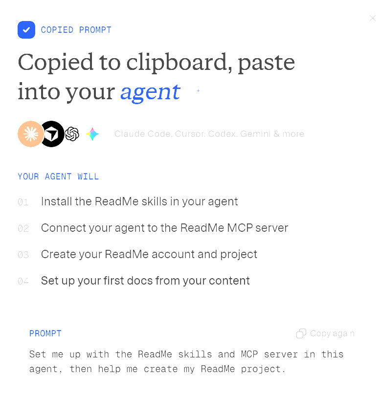
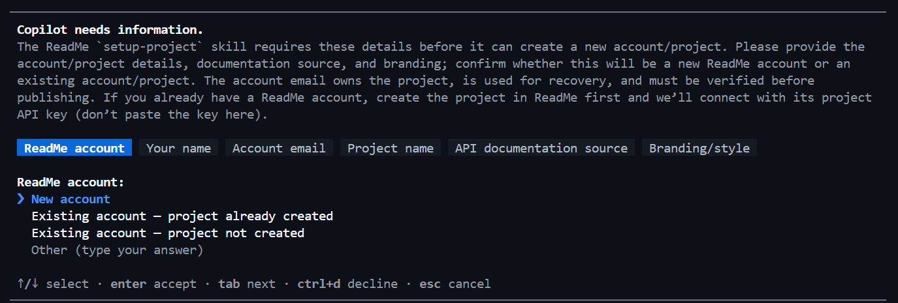
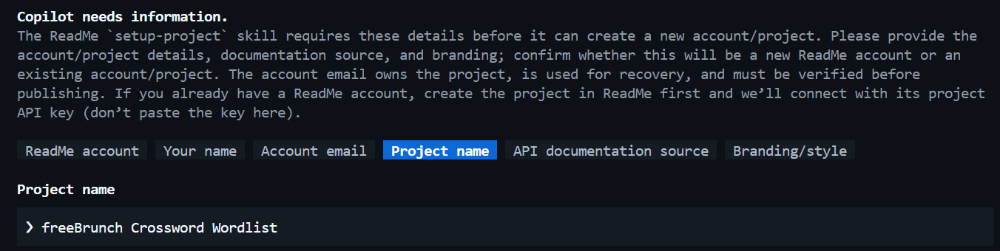
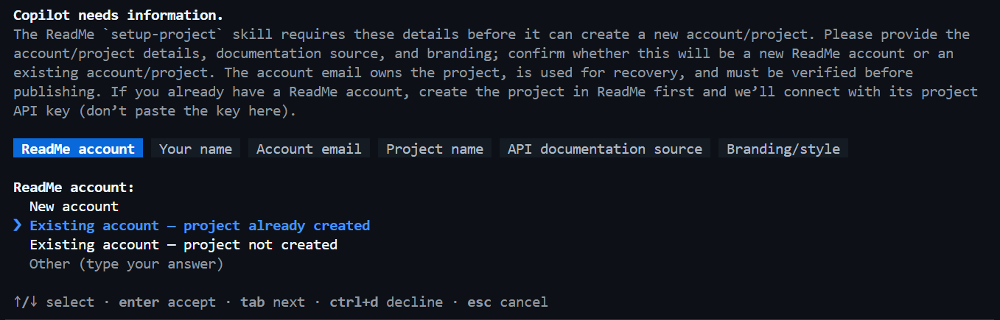
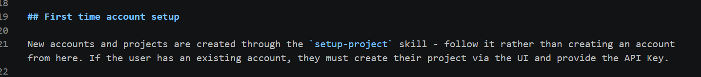
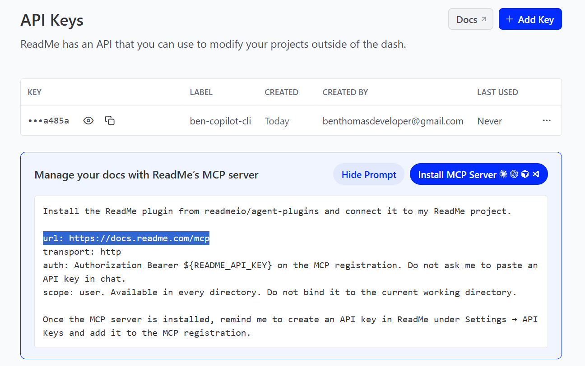
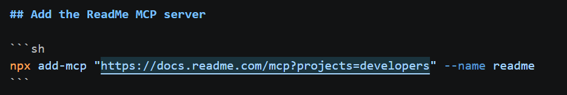
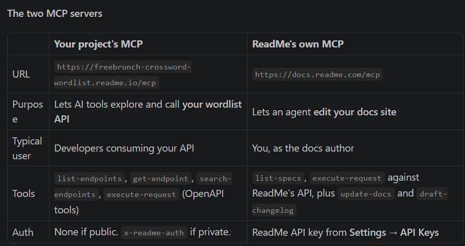

The get started with agent on homepage - https://readme.com/ - does a great job of setting up project with mcp/skills but doesn't exactly push you forward or provide a prompt to start using the MCP, create a new project, etc. I had to drive that and come up with a prompt

After that was extremely impressed by the hand held guidance through the setup process.

I wasn't sure if Project name was strict hyphenated url or just a display name (this was an existing project)

Oh i'm realizing i selected existing account - project already created and its still prompting me through all the new project questions

hmm somehow even with this context in the MCP skill the agent totally whiffed here, i think its because it had only loaded the setup-project skill. which is weird because the setup-project skill's first recommendation is to use the mcp-auth skill. chaining skills might be a bit brittle

This URL is wrong, it should be https://docs.readme.com/main/docs/mcp

Is Restless essentially replacing public access to Docs via README MCP? 

The skill is consistently trying to get me to connect to this mcp url

rather than `"url": "https://your-project.readme.io/mcp",` which is mentioned in the docs?

ok i see, i was confused about this

